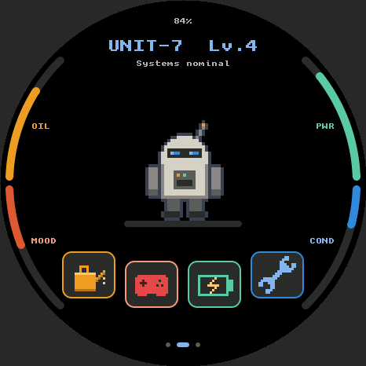
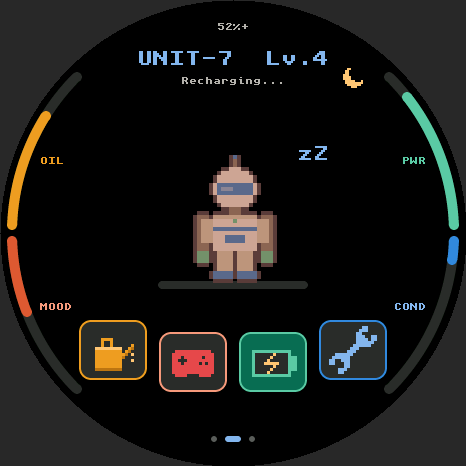
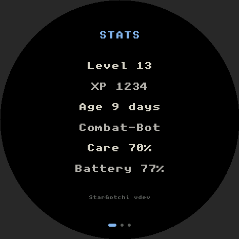
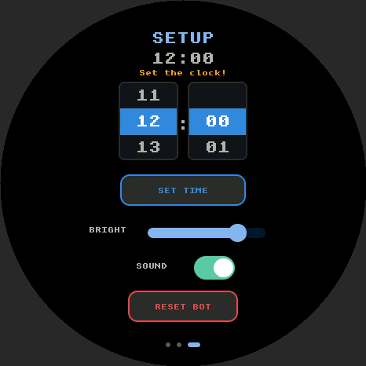
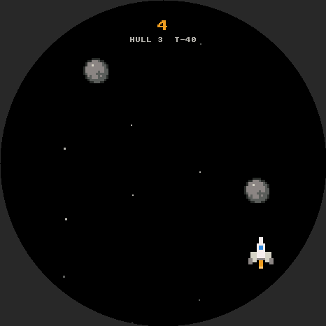

# StarGotchi

A space-adventure virtual pet for the **Waveshare ESP32-S3-Touch-AMOLED-1.75**.
Raise a little bot from a glowing core to its final form – keep it oiled,
charged, repaired and entertained.

**Install:** https://skinner2002.github.io/stargotchi/ (Chrome or Edge, USB cable)

| Home | Night | Stats | Setup | Mini-game |
|---|---|---|---|---|
|  |  |  |  |  |

Screenshots are rendered with the real UI code by `tools/sim/run_sim.sh`.

## Development

- `tools/run_tests.sh` – unit tests for the game logic (g++, Python 3 + Pillow)
- `tools/build.sh [version]` – firmware build with arduino-cli
  (core esp32:esp32@3.3.10, lvgl 8.4.0, GFX Library for Arduino 1.6.4,
  SensorLib 0.3.1, XPowersLib 0.2.6; copy `firmware/lv_conf.h` into your
  Arduino libraries folder)
- `tools/make_site.sh <version>` – installer site in `site/`
- `tools/sim/run_sim.sh` – renders UI screenshots on the desktop
- `tools/sprites.py` – converts `assets/sprites/*.txt` pixel maps to C arrays

MakerWorld text: `docs/makerworld.md`. Uses code from Waveshare's examples (Apache-2.0).

Every push to `main` runs the tests, builds the firmware and publishes the
installer page via GitHub Pages.
